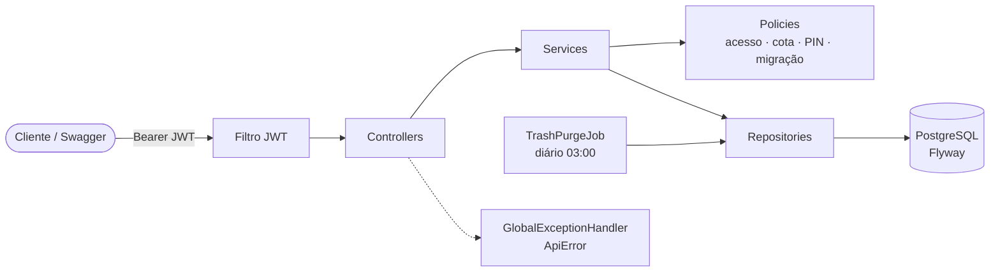
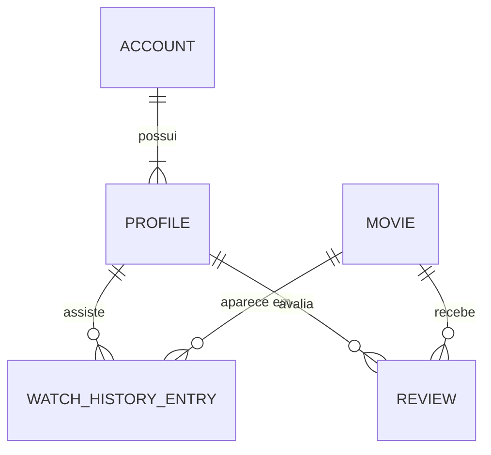

# streaming-api

[🇺🇸 English](README.md) | 🇧🇷 Português (Brasil)

**[Visão geral da arquitetura →](https://joaoalbertorsc.github.io/streaming-api/)** fluxo de uma requisição, modelo de domínio, simulador interativo do catálogo, endpoints e testes.

Projeto de prática: simulação de uma API de streaming (contas, perfis, planos, catálogo filtrado
por idade e plano, histórico de visualização e avaliações). Veja o `streaming-api-plan.md` para o
modelo de domínio completo, a arquitetura, o contrato da API e o checklist de TDD.

## Arquitetura

Aplicação Spring Boot organizada por funcionalidade. Os controllers só cuidam de HTTP, cada serviço orquestra um caso de uso, e cada regra de negócio fica numa classe de política pequena.





## Requisitos

- JDK 21
- Maven 3.9+
- Docker (PostgreSQL local e testes com Testcontainers)

## Configuração local

1. Crie o seu arquivo de configuração local (credenciais do banco e segredo JWT). Ele é ignorado
   pelo git:

   ```bash
   cp .env.example .env
   ```

   Defina `JWT_SECRET` com um texto aleatório de pelo menos 32 caracteres
   (`openssl rand -base64 48`). A aplicação lê o `.env` automaticamente; variáveis de ambiente reais
   têm prioridade sobre ele.

2. Suba o PostgreSQL:

   ```bash
   docker compose up -d
   ```

   Isso inicia o `streaming-postgres` (PostgreSQL 16) na porta 5432, com o banco `streaming` e um
   volume persistente. Conecte pelo DBeaver usando as credenciais do `.env`.

3. Rode a aplicação (ou execute `StreamingApiApplication` pela IDE, com a raiz do projeto como
   diretório de trabalho para que o `.env` seja encontrado):

   ```bash
   mvn spring-boot:run
   ```

   Na primeira execução, o Flyway cria o schema e carrega 20 filmes.

## Testes

```bash
  mvn test
```

- Os testes unitários e os `@WebMvcTest` não precisam de mais nada.
- Os testes de repositório de filmes e de histórico usam H2 em modo PostgreSQL (perfil `test`).
- O `ProfileRepositoryTest` (índice único parcial) e o `StreamingApiIntegrationTest` (fluxos de
  ponta a ponta) sobem um PostgreSQL temporário via Testcontainers, então o Docker precisa estar
  rodando.

## Swagger

`http://localhost:8080/swagger-ui.html`. Chame `POST /api/v1/auth/register` ou `/login` e use o
token retornado no botão **Authorize**.
